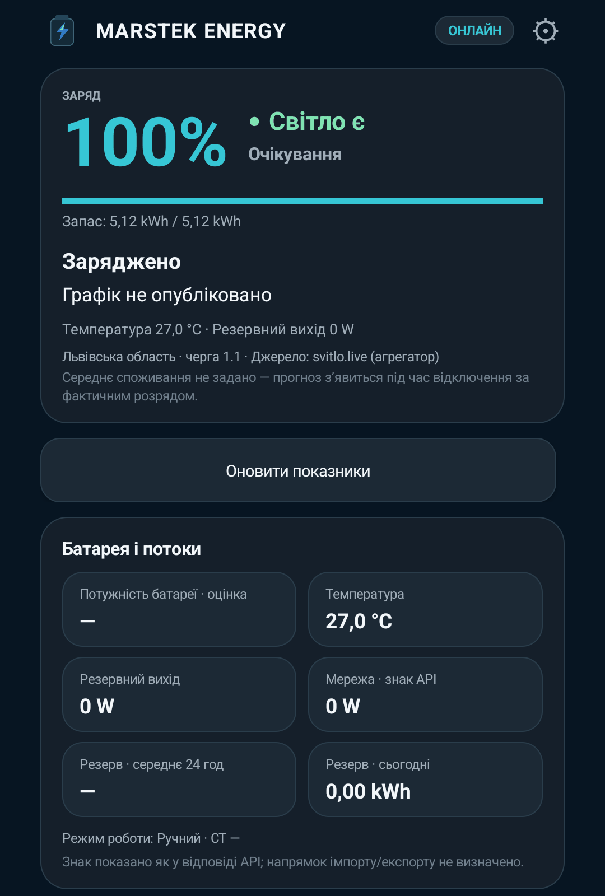
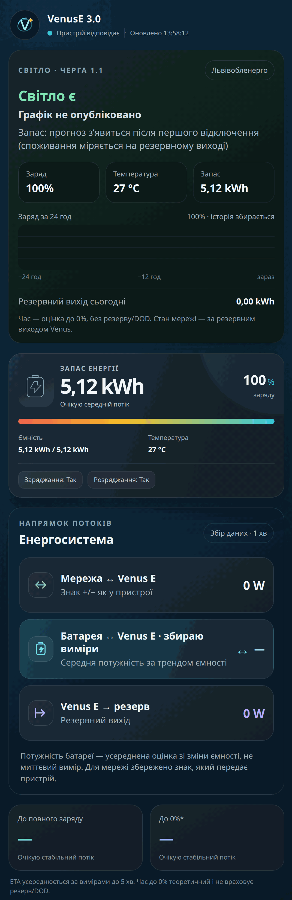

# Marstek Venus Monitor

Неофіційний **read-only** моніторинг домашньої батареї **Marstek Venus E** (перевірено на Venus E 3.0): Android-застосунок з віджетами та сповіщеннями + необов'язковий маленький сервер з веб-дашбордом, історією і графіком відключень для всієї України.

> Застосунок і сервер **нічим не керують**: вони лише читають стан батареї через локальний Open API. Потужність батареї й час до 100% / 0% — оцінка за зміною заряду, а не точний вимір.

| Застосунок | Віджети | Дашборд сервера |
|---|---|---|
|  |  |  |

<sub>Скриншоти з реальної Venus E 3.0 (режим «Напряму по Wi‑Fi», графік — Львівська область, черга 1.1). Більше — у [посібнику](docs/MANUAL.md).</sub>

## Два режими

| | **Напряму по Wi‑Fi** | **Сервер** |
|---|---|---|
| Що потрібно | лише телефон із застосунком | ПК / Raspberry Pi / NAS удома, Docker або Python 3 |
| Де працює | тільки в домашній мережі | вдома і поза домом (через VPN / тунель) |
| Історія заряду | лише поки застосунок відкритий | 48 год (SQLite) |
| Сповіщення, коли ви не вдома | ні | так |
| Графік відключень | так (з інтернету) | так, кешує сервер |
| Веб-дашборд (PWA) | ні | так |

Батарея відповідає **лише в локальній мережі** (UDP 30000). Щоб бачити її з мобільного інтернету, потрібен хтось удома, хто опитує її і віддає готовий JSON, — це і є сервер. Детально: [FAQ](docs/MANUAL.md#faq).

```
Venus E ──UDP JSON-RPC (Open API, LAN)──▶ server/ (Python, ПК/RPi/NAS удома)
                                           │  історія 48 год, графік відключень
                                           ▼
                                HTTP /api/status + веб-дашборд
                                           │  (LAN / Tailscale / WireGuard / Cloudflare Tunnel)
                                           ▼
                               Android-застосунок + віджети
```

## Що вміє

- **Заряд, запас kWh, температура, потоки** мережа ↔ батарея ↔ резервний вихід, ETA до 100% / до 0%, графік заряду за 24 год, накопичені лічильники.
- **Світло є / нема** — за потужністю на резервному виході батареї (якщо до нього підключене хоч щось: роутер, ONT, лампа).
- **Графік відключень для всіх областей**: поточне й наступне відключення вашої черги, «можливі» відключення окремо, аварійні відключення, і чи вистачить запасу батареї (і на скільки годин).
- **Android**: головний екран, віджети 4×1, 2×2, 4×2, сповіщення (відключення скоро, запасу не вистачить, новий графік, світло зникло/повернулось, заряджання почалось/завершилось, велике споживання, заряд 20% / 10%, температура, дані застаріли).
- **Сервер**: Python 3 без залежностей, Docker-образ, необов'язковий токен доступу, обмеження частоти запитів.

## Джерела графіків відключень

Сервер спершу бере дані **напряму в оператора**, а агрегатори — як запасний варіант (`MARSTEK_OUTAGE_PROVIDER=auto`):

1. **Офіційне API напряму**: Львівобленерго (Львівська обл.), YASNO (Київ, Дніпро — ДнЕМ і ЦЕК).
2. **[hukpo/ua-outages](https://github.com/hukpo/ua-outages)** — статичний агрегат, що кожні ~15 хв читає сайти ~22 операторів.
3. **[svitlo.live](https://svitlo.live)** — публічні проксі агрегатора (формат як у Home Assistant-інтеграції chaichuk/svitlo_live).

Таблиця по областях — у [посібнику](docs/MANUAL.md#джерела-графіків-по-областях). Поле `power_outage.source` у `/api/status` показує, звідки взято графік саме зараз; дашборд пише це у верхній картці.

## Швидкий старт сервера

```bash
git clone https://github.com/jonydhub/marstek-venus-monitor.git
cd marstek-venus-monitor/server
cp docker-compose.example.yml docker-compose.yml   # впишіть MARSTEK_HOST, токен, регіон і чергу
docker compose up -d
```

Без Docker: `cp config.example.env .env`, відредагувати, `python3 -B server.py`. Усі змінні — у [посібнику](docs/MANUAL.md#змінні-середовища).

## Структура

- `server/` — Python 3 (stdlib): опитування батареї, `/api/status`, `/api/regions`, `/health`, веб-дашборд, джерела відключень (`outage.py`, `yasno.py`, `uaoutages.py`, `svitlo.py`, `regions.py`), історія (`history.py`). Тести: `cd server && python3 -B -m unittest discover -s tests`.
- `android/` — Kotlin, minSdk 26, RemoteViews-віджети, WorkManager.
- `docs/MANUAL.md` — покроковий посібник.

## Обмеження

- Потрібен увімкнений **Open API** у застосунку Marstek; без нього батарея не відповідає.
- «Світла нема» визначається лише якщо від резервного виходу щось живиться (≥ 5 Вт за замовчуванням).
- Графік — те, що публікує оператор; агрегатори можуть запізнюватись. Важливе перевіряйте на сайті свого обленерго.
- Перевірено на одній Venus E 3.0. Інші моделі з тим самим Open API, ймовірно, працюватимуть, але не перевірені.

## Приватність

- Тільки читання: жодних команд керування батареєю.
- Дані батареї залишаються у вас: телефон ↔ батарея або телефон ↔ ваш сервер. Хмари проєкту немає, телеметрії немає.
- В інтернет сервер звертається лише по графік відключень (публічні JSON операторів, ua-outages, svitlo.live) — без даних батареї.

## Ліцензія та подяки

MIT, див. [LICENSE](LICENSE). Сторонні джерела й ліцензії — [NOTICE](NOTICE): [hukpo/ua-outages](https://github.com/hukpo/ua-outages) (MIT), [svitlo.live](https://svitlo.live) / [chaichuk/svitlo_live](https://github.com/chaichuk/svitlo_live) (MIT), відкриті дані Львівобленерго, публічне API YASNO.

**Проєкт не пов'язаний з Marstek, ДТЕК, YASNO, обленерго, ua-outages чи svitlo.live.** Назви й торгові марки належать їхнім власникам. Використовуйте на власний ризик.

---

## English

**Marstek Venus Monitor** is an unofficial, read-only monitor for the Marstek Venus E home battery: an Android app with widgets and notifications, plus an optional stdlib-only Python server (Docker image included) that polls the battery's local Open API (UDP JSON-RPC, port 30000), keeps 48 h of history, serves a PWA dashboard and `/api/status`, and merges Ukrainian power-outage schedules — official operator APIs first (Lvivoblenergo, YASNO), then the [hukpo/ua-outages](https://github.com/hukpo/ua-outages) aggregate, then svitlo.live. It never sends control commands. The battery only answers on the LAN, so remote access needs the home server plus a VPN or tunnel; set `MARSTEK_API_TOKEN` before exposing it anywhere. MIT licensed; not affiliated with Marstek or any grid operator. Full manual (Ukrainian): [docs/MANUAL.md](docs/MANUAL.md).
