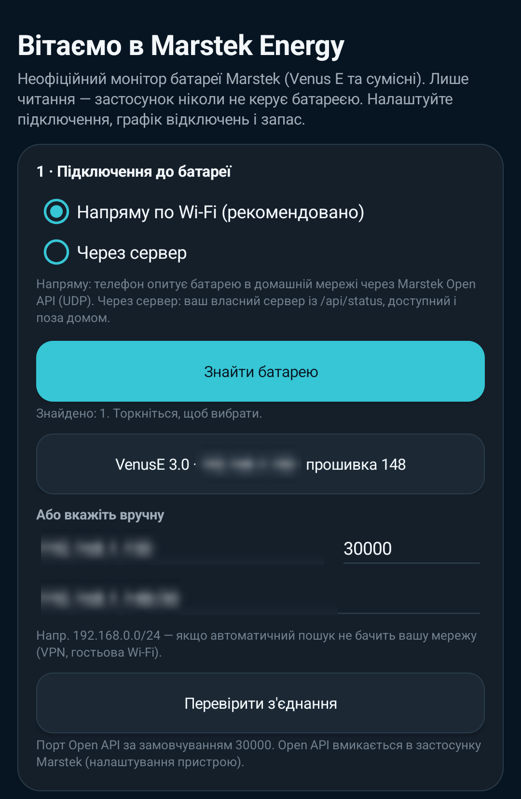
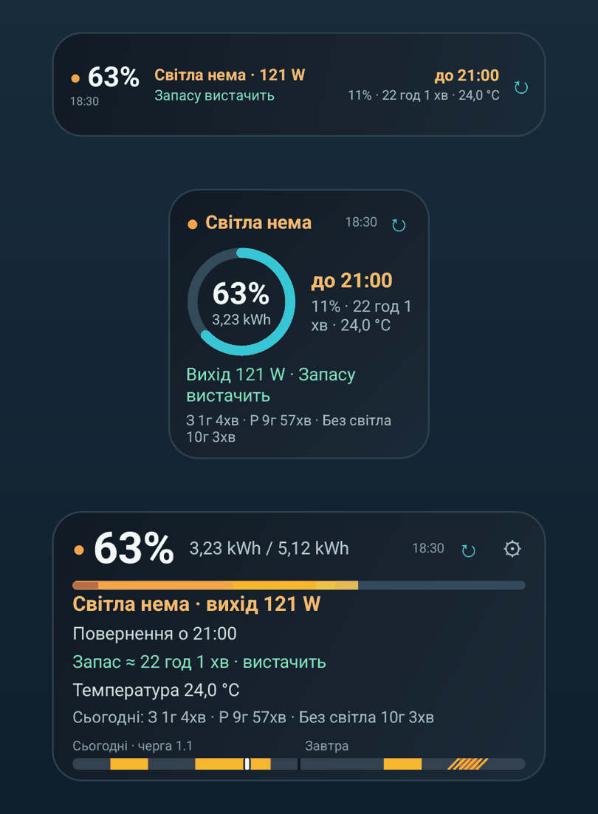
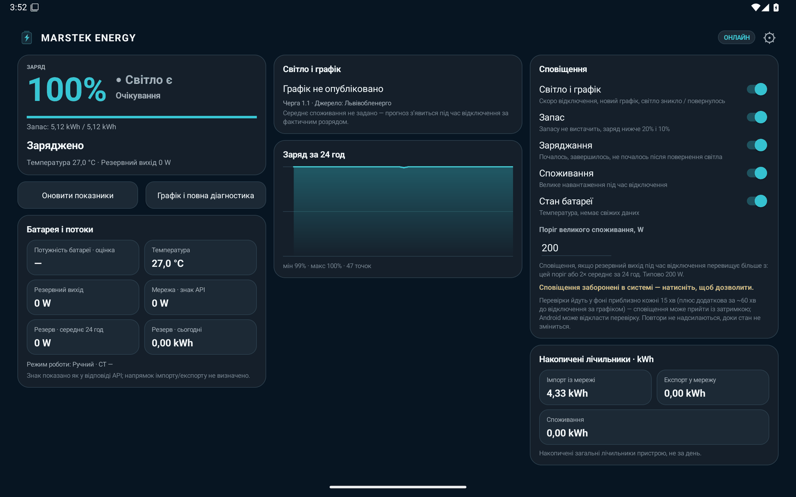
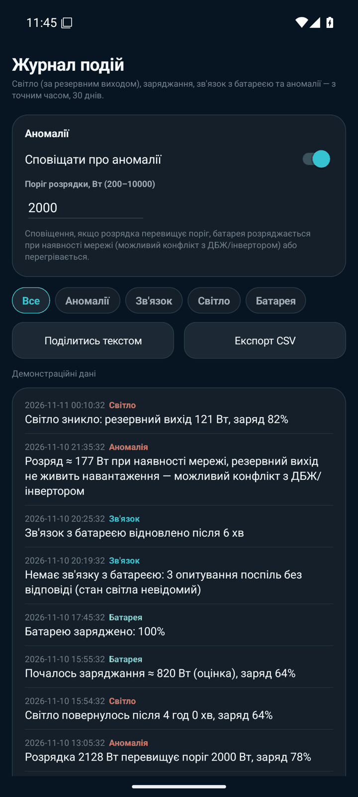
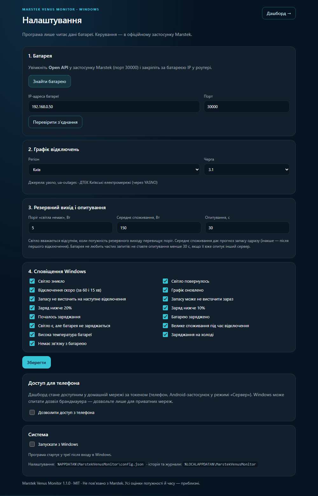
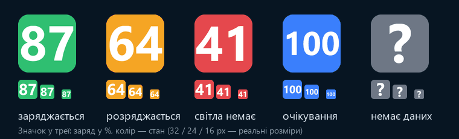

# Посібник користувача — Marstek Venus Monitor

Покроково: від увімкнення Open API на батареї до віджетів, сповіщень і власного сервера з доступом поза домом.

> Застосунок і сервер **лише читають** дані. Керувати батареєю (режими, заряд, розряд) і далі треба в офіційному застосунку Marstek.

- [1. Увімкнути Open API на батареї](#1-увімкнути-open-api-на-батареї)
- [2. Фіксована IP-адреса батареї](#2-фіксована-ip-адреса-батареї)
- [3. Встановлення APK](#3-встановлення-apk)
- [4. Перший запуск](#4-перший-запуск)
- [5. Віджети](#5-віджети)
- [6. Сповіщення](#6-сповіщення)
- [7. Сервер](#7-сервер)
- [8. Доступ поза домом](#8-доступ-поза-домом)
- [9. Джерела графіків по областях](#джерела-графіків-по-областях)
- [10. Якщо щось не працює](#10-якщо-щось-не-працює)
- [11. Windows-програма](#11-windows-програма)
- [FAQ](#faq)

## 1. Увімкнути Open API на батареї

Venus E має локальний **Open API** (його ще називають Local API): батарея відповідає на JSON-запити по UDP у вашій домашній мережі. За замовчуванням він вимкнений.

1. Відкрийте офіційний застосунок **Marstek** і переконайтесь, що батарея під'єднана до домашнього Wi‑Fi (2,4 ГГц).
2. Відкрийте сторінку пристрою → налаштування / «Більше» / «Advanced».
3. Знайдіть пункт на кшталт **Open API**, **Local API** або **API для розробників** і увімкніть його.
4. Порт залиште **30000** (або запам'ятайте свій).

> Точна назва й розташування пункту залежать від версії застосунку Marstek і прошивки батареї. Якщо пункту немає — оновіть застосунок і прошивку батареї; в окремих версіях API вмикається через підтримку Marstek.

## 2. Фіксована IP-адреса батареї

Застосунок і сервер звертаються до батареї за IP-адресою, тож вона не повинна змінюватися.

1. Зайдіть у веб-інтерфейс роутера (адреса зазвичай на наклейці роутера, напр. `192.168.0.1`).
2. Знайдіть список DHCP-клієнтів і батарею (ім'я на кшталт `Venus`/`MST`, або за MAC-адресою з застосунку Marstek).
3. Зробіть **DHCP-резервацію** («Address reservation», «Static lease», «Прив'язка IP до MAC»).
4. Перезавантажте батарею або вимкніть/увімкніть її Wi‑Fi, щоб вона отримала зарезервовану адресу.

## 3. Встановлення APK

1. Відкрийте на телефоні [пряме посилання на останню версію](https://github.com/jonydhub/marstek-venus-monitor/releases/latest/download/Marstek-Venus-Monitor.apk) або сторінку [Releases](https://github.com/jonydhub/marstek-venus-monitor/releases) і завантажте `.apk`.
   Перевірити файл можна за SHA-256, вказаним у релізі. Сертифікат підпису (SHA-256): `1D:E8:B6:47:55:3F:43:85:9B:66:2B:C0:F9:1B:1F:8A:2C:AA:96:BD:78:91:D7:97:6E:3E:18:A1:0B:9D:4B:22`.
2. Відкрийте файл. Android попросить дозволити встановлення з **невідомих джерел** для браузера або файлового менеджера — дозвольте лише для нього.
3. Після встановлення цей дозвіл можна вимкнути назад.

## 4. Перший запуск



<sub>IP-адресу знайденої батареї на скриншоті розмито.</sub>

1. **Режим**: «Напряму по Wi‑Fi» (лише вдома) або «Сервер» (потрібна адреса вашого сервера і, якщо задано, токен).
2. **Пошук батареї**: застосунок шукає Venus у поточній Wi‑Fi мережі. Якщо не знайшов — введіть IP вручну (з кроку 2) і порт (30000).
3. **Регіон і черга**: виберіть область/місто і свою чергу (напр. `3.1`). Чергу можна дізнатися на сайті свого обленерго за адресою або в рахунку/застосунку оператора.
4. **Споживання**: якщо знаєте середнє навантаження на резервному виході (Вт) — вкажіть, це дасть прогноз запасу одразу. Інакше прогноз з'явиться після першого відключення, коли буде виміряно реальне споживання.

## 5. Віджети

Довге натискання на порожньому місці головного екрана → **Віджети** → **Marstek** → перетягніть потрібний розмір.



| Розмір | Що показує |
|---|---|
| **4×1** | заряд %, світло є/нема, найближча подія (відключення / повернення / до 100%) |
| **2×2** | кільце заряду з kWh, стан мережі, скільки вистачить або до 100 %, наступне відключення; на більших клітинках (Samsung, Pixel ≈ 160–190 dp) — більше кільце й шрифт і рядок «сьогодні» (З · Р · Без світла) |
| **4×2** | усе вище + час до резерву / 100%, чи вистачить запасу, «сьогодні», смуга графіка сьогодні + завтра |
| **4×4** і більше | усе вище + блок «Світло є/нема · черга», мережа і резервний вихід; на планшеті (від ~6×4) — те саме більшим шрифтом |

Вміст кожного розміру розподіляється по всій висоті клітинки — без порожніх смуг зверху й знизу.

Розмір віджета можна змінювати: вигляд підлаштовується під фактичну клітинку лаунчера (вузька смуга, квадрат, широка картка, великий блок).

Віджети оновлюються приблизно раз на 15 хв (обмеження Android). Натискання відкриває застосунок і оновлює дані одразу.

### Планшети та розділений екран

Застосунок не прив'язаний до орієнтації. Розкладка залежить від доступної ширини вікна, а не від типу пристрою:

| Ширина вікна | Розкладка |
|---|---|
| менше 600 dp (телефон, вузьке вікно) | одна колонка |
| 600–839 dp (планшет у портреті, розкладний телефон) | дві колонки: ліворуч заряд, кнопки, потоки й лічильники; праворуч світло і графік, «На що звернути увагу», графік заряду за 24 год, сповіщення |
| 840–1099 dp (телефон у ландшафті, розкладний телефон) | дві широкі колонки, більший графік заряду |
| від 1100 dp (планшет у ландшафті) | три колонки, ще більший графік заряду |

На планшеті шрифт трохи більший, а ширина вмісту обмежена, щоб рядки лишалися читабельними. Поворот і зміна розміру вікна (split-screen) перебудовують екран із збережених даних — без повторного опитування. Налаштування, перший запуск і «Про застосунок» — центрована колонка шириною до 640 dp.



### Головний екран

Головний екран — повний вигляд, окремий веб-дашборд для цього не потрібен:

- **Світло** (один раз, угорі): «Світло є» / «Світла нема» — за резервним виходом; «Немає зв'язку з батареєю», якщо батарея (або сервер) не відповідає. Якщо зв'язку немає, а за графіком зараз відключення, нижче буде підказка «за графіком зараз відключення» — але стан лишається невідомим.
- **Скільки вистачить**: під час відключення — «Вистачить на 22 год 0 хв», нижче «121 Вт · світло о 23:00»; при заряджанні — до 100 %; повністю заряджена в очікуванні — «Заряджено».
- **Сьогодні**: три плитки — «Заряд», «Розряд», «Без світла» (час з 00:00).
- **Сьогодні і завтра**: смуга 0–24 | 0–24, відключення — жовтим, «можливі» — штрихуванням, біла риска — зараз.
- **Заряд за 24 год**: затінені періоди без світла, позначки ● світло зникло, ○ повернулось, ⚡ почалось заряджання, ✓ заряджено, червона пунктирна лінія — резерв розряду.
- Батарея і потоки, накопичені лічильники, **Журнал подій** (останні події + кнопка), сповіщення, **Діагностика** (згорнута).
- ↻ у заголовку — оновити зараз, ⚙ — налаштування. У режимі сервера в налаштуваннях є «Відкрити веб-дашборд сервера».

### Як рахується «скільки вистачить»

Venus перестає віддавати енергію на порозі розряду BMS (типово ≈ 11–12 %). Open API цей поріг не повідомляє (жодного `Get`-методу для нього немає), тому він задається в налаштуваннях застосунку («Резерв розряду», типово 11 %) або на сервері `MARSTEK_DISCHARGE_FLOOR_PCT`.

`час = (запас − ємність × резерв %) ÷ навантаження`

Навантаження під час відключення — **виміряна** потужність резервного виходу (`offgrid_power`); якщо її немає — оцінка розряду за трендом ємності, далі задане середнє споживання, далі середнє резервного виходу за 24 год. Приклад: 63 % від 5,12 kWh при 121 Вт — (3226 − 563) Wh ÷ 121 Вт ≈ **22 год 0 хв** (до 1.2.0 рахувалось до 0 %: 3226 ÷ 121 ≈ 26 год 40 хв). Втрати інвертора не моделюються, тож реальний час буде трохи меншим.

### Журнал подій

**Журнал подій** (кнопка на головному екрані) — події з точним часом за 30 днів:



| Категорія | Події |
|---|---|
| Світло | світло зникло (резервний вихід почав споживати) / повернулось (із тривалістю) |
| Батарея | заряджання почалось / зупинилось, заряджено |
| Зв'язок | немає зв'язку з батареєю (3 опитування поспіль без відповіді) / відновлено — **окремо від світла** |
| Аномалія | розрядка вище порогу (200–10000 Вт, типово 2000), розряд при наявності мережі з бездіяльним резервним виходом (можливий конфлікт з ДБЖ/інвертором), температура понад 45 °C |

Фільтр «Все / Аномалії / Зв'язок / Світло / Батарея», **Поділитись текстом** і **Експорт CSV** (лише час, категорія, значення й текст — без адрес і назв мереж). Перемикач «Сповіщати про аномалії» і поріг — там само. У режимі «Напряму» журнал веде телефон (коли він опитує батарею), у режимі сервера — сервер (`GET /api/events`), поріг тоді задає `MARSTEK_ANOMALY_DISCHARGE_W`.

«Мережі немає, а батарея не віддає живлення» окремо не виявляється: без незалежного датчика мережі «світла нема» визначається саме тим, що резервний вихід споживає.

## 6. Сповіщення

Кожне можна вимкнути окремо в налаштуваннях застосунку.

| Сповіщення | Коли |
|---|---|
| Відключення скоро | за ~1 год до відключення за графіком вашої черги |
| Запасу не вистачить | прогноз автономії коротший за найближче відключення — варто дозарядити |
| Опубліковано графік | з'явився або змінився графік на сьогодні / завтра |
| Світло зникло | батарея почала живити резервний вихід |
| Світло повернулось | живлення з мережі відновилося |
| Заряджання почалось | батарея почала заряджатися |
| Заряджено повністю | досягнуто 100% |
| Не заряджається після повернення світла | світло є, а батарея не заряджається — перевірте режим у застосунку Marstek |
| Велике навантаження | споживання на резервному виході вище порогу |
| Заряд 20% / 10% | низький заряд під час відключення |
| Температура | температура батареї поза нормальним діапазоном |
| Дані застаріли | батарея / сервер давно не відповідають (це не «світла нема») |
| Аномалія | розрядка вище порогу, розряд при наявності мережі, перегрів (вмикається в «Журналі подій») |

> У режимі «Напряму по Wi‑Fi» сповіщення працюють, лише коли телефон у домашній мережі. Щоб отримувати їх будь-де, потрібен [сервер](#7-сервер).

## 7. Сервер

Сервер — маленька програма на Python 3 без залежностей. Підійде будь-що, що постійно ввімкнене вдома: Raspberry Pi, міні-ПК, NAS з Docker. Бажано, щоб він (і роутер) теж був підключений до резервного виходу або до UPS — не для визначення світла (воно завжди за потужністю резервного виходу), а щоб сервер **продовжував опитувати** батарею під час відключення.

### Docker (рекомендовано)

```bash
git clone https://github.com/jonydhub/marstek-venus-monitor.git
cd marstek-venus-monitor/server
cp docker-compose.example.yml docker-compose.yml
nano docker-compose.yml        # MARSTEK_HOST, MARSTEK_API_TOKEN, MARSTEK_OUTAGE_REGION, MARSTEK_OUTAGE_QUEUE
docker compose up -d
```

Або одним рядком (Linux, host-мережа):

```bash
docker build -t marstek-venus-monitor ./server && \
docker run -d --name marstek --restart unless-stopped --network host -v marstek-data:/data \
  -e MARSTEK_HOST=192.168.0.50 -e MARSTEK_API_TOKEN="$(openssl rand -hex 24)" \
  -e MARSTEK_OUTAGE_REGION=kyiv -e MARSTEK_OUTAGE_QUEUE=3.1 marstek-venus-monitor
```

`--network host` потрібен, бо сервер спілкується з батареєю по UDP у вашій LAN. Docker Desktop (macOS/Windows) host-мережі не має — див. варіант з `ports:` у `docker-compose.example.yml`. Перевірка: `curl http://127.0.0.1:8767/health`.

Токен, згенерований у прикладі, подивитися: `docker inspect marstek --format '{{range .Config.Env}}{{println .}}{{end}}' | grep TOKEN`.

### Без Docker (systemd)

```bash
cd ~/marstek-venus-monitor/server
cp config.example.env .env && nano .env
mkdir -p data && python3 -B server.py          # перевірити вручну, Ctrl+C
cp deploy/marstek-monitor.service.example ~/.config/systemd/user/marstek-monitor.service
systemctl --user daemon-reload && systemctl --user enable --now marstek-monitor
loginctl enable-linger "$USER"
```

### Змінні середовища

Їх можна задати у середовищі, у `server/.env` або у файлі за шляхом `MARSTEK_CONFIG`. Змінні середовища мають пріоритет над файлом.

| Змінна | За замовчуванням | Що це |
|---|---|---|
| `MARSTEK_HOST` | — (**обов'язково**) | IP батареї в LAN |
| `MARSTEK_PORT` | `30000` | UDP-порт Open API |
| `MARSTEK_BIND` | `127.0.0.1` | на якій адресі слухати HTTP; `0.0.0.0` — усі інтерфейси (у Docker-образі вже `0.0.0.0`) |
| `MARSTEK_DASHBOARD_PORT` | `8767` | HTTP-порт |
| `MARSTEK_API_TOKEN` | порожньо | якщо задано, `/api/*` вимагає `Authorization: Bearer <токен>` |
| `MARSTEK_RATE_LIMIT_PER_MIN` | `120` | запитів до `/api/*` за хвилину з однієї IP |
| `MARSTEK_OUTAGE_PROVIDER` | `auto`, якщо задано регіон, інакше `off` | `auto` · `ua-outages` · `loe` · `yasno` · `off` |
| `MARSTEK_OUTAGE_REGION` | — | id регіону з таблиці нижче (або з `GET /api/regions`) |
| `MARSTEK_OUTAGE_QUEUE` | — | черга, напр. `3.1` |
| `MARSTEK_OUTAGE_OTG_ID`, `_CITY_ID`, `_STREET_ID`, `_BUILDING` | — | лише Львівобленерго: аварійні відключення за адресою (необов'язково) |
| `MARSTEK_BACKUP_THRESHOLD_W` | `5` | від скількох Вт на резервному виході вважати, що світла нема |
| `MARSTEK_EXPECTED_LOAD_W` | — | середнє навантаження резервного виходу для прогнозу (інакше — з історії) |
| `MARSTEK_DISCHARGE_FLOOR_PCT` | `11` | резерв розряду BMS, % (0–50): прогноз рахує лише енергію понад нього; червона лінія на графіку |
| `MARSTEK_ANOMALY_DISCHARGE_W` | `2000` | поріг аномалії «розрядка вище порогу» в журналі (200–10000) |
| `MARSTEK_HISTORY_DB` | `server/data/history.db` (`/data/history.db` у Docker) | файл історії |

### API

| Запит | Відповідь |
|---|---|
| `GET /health` | `{"ok": true, "device_responding": …, "last_poll_age_seconds": …}` — без токена, без IP |
| `GET /api/status` | повний знімок: методи батареї, `battery_flow`, `insights`, `power_outage` |
| `GET /api/regions` | `{"regions": [{"id", "name_ua", "operator", "queues", "sources"}]}` — для екранів налаштування |

Ключові поля `power_outage`: `grid_state` (`on`/`off`/`unknown` — за резервним виходом), `current_outage`, `next_outage`, `maybe_outages` (можливі відключення, окремо від точних), `schedule_published`, `emergency` (діють аварійні — графік не застосовується), `provider` (налаштований режим), `source` (`loe`/`yasno`/`kharkiv`/`poltava`/`zaporizhzhia`/`chernivtsi`/`ua-outages` — звідки взято зараз), `schedule_unavailable` (для області немає джерела графіка), `source_detail` (оператор), `source_errors`, `source_stale`, `autonomy`.

`GET /api/events?limit=200[&category=light|battery|connection|anomaly]` — журнал подій (новіші першими, 30 днів): `{"events":[{"ts","kind","category","text","value"}]}`. У `/api/status`: `insights.today` (`charge_seconds`, `discharge_seconds`, `outage_seconds` з 00:00), `insights.outage_periods`, `insights.chart_events`, `power_outage.windows` (сьогодні + завтра, `kind` `off`/`maybe`), `power_outage.autonomy.floor_pct` / `usable_wh` / `load_basis` (`measured_backup_output` під час відключення), `connection.lost` (3 невдалі опитування поспіль).

### Веб-дашборд і токен

Відкрийте `http://<сервер>:8767/`. Якщо задано токен, дашборд попросить його й збереже в цьому браузері (localStorage). Можна один раз відкрити `http://<сервер>:8767/?token=<токен>` — токен збережеться, а з адресного рядка зникне.

## 8. Доступ поза домом

Батарея доступна лише в домашній мережі, тому поза домом телефон ходить до **сервера**. Варіанти — від найбезпечнішого:

1. **Tailscale** (рекомендовано): встановіть на сервер і телефон, увійдіть одним акаунтом. У застосунку вкажіть `http://<tailscale-ip-сервера>:8767`. Для цього на сервері `MARSTEK_BIND=0.0.0.0` (або tailscale-IP) і все одно задайте токен.
2. **WireGuard** на роутері або сервері — те саме, лише налаштування вручну.
3. **Cloudflare Tunnel + Cloudflare Access** — якщо потрібна публічна HTTPS-адреса: тунель до `http://127.0.0.1:8767`, політика Access (вхід через пошту/Google) **і** `MARSTEK_API_TOKEN`.

> **Ніколи** не прокидайте порт сервера на роутері в інтернет без токена й HTTPS. Навіть read-only дані показують, коли вас немає вдома і коли нема світла.

## Джерела графіків по областях

У режимі `auto` сервер пробує джерела зліва направо й бере перше, що дало графік (або повідомило про аварійні відключення). Якщо офіційне джерело не відповідає чи порожнє — береться наступне; у `/api/status` це видно в `source` і `source_errors`.

| `MARSTEK_OUTAGE_REGION` | Область | Оператор | Ланцюг `auto` |
|---|---|---|---|
| `kyiv` | Київ | ДТЕК Київські електромережі (через YASNO) | YASNO (напряму) → ua-outages |
| `kyiv-region` | Київська область | ДТЕК Київські регіональні електромережі | ua-outages |
| `dnipro` | Дніпропетровська область (ДТЕК) | ДТЕК Дніпровські електромережі (через YASNO) | YASNO (напряму) → ua-outages |
| `dnipro-cek` | Дніпропетровська область (ЦЕК) | Центральна енергетична компанія (через YASNO) | YASNO (напряму) → ua-outages |
| `lviv` | Львівська область | Львівобленерго | Львівобленерго (напряму) → ua-outages |
| `odesa` | Одеська область | ДТЕК Одеські електромережі | ua-outages |
| `donetsk` | Донецька область | ДТЕК Донецькі електромережі | ua-outages |
| `kharkiv` | Харківська область | Харківобленерго | Харківобленерго (напряму, сайт обленерго) → ua-outages |
| `poltava` | Полтавська область | Полтаваобленерго | Полтаваобленерго (напряму, сайт обленерго) → ua-outages |
| `zaporizhzhia` | Запорізька область | Запоріжжяобленерго | Запоріжжяобленерго (напряму, сайт обленерго) → ua-outages |
| `mykolaiv` | Миколаївська область | Миколаївобленерго | ua-outages |
| `kirovohrad` | Кіровоградська область | Кіровоградобленерго | ua-outages |
| `cherkasy` | Черкаська область | Черкасиобленерго | ua-outages |
| `sumy` | Сумська область | Сумиобленерго | ua-outages |
| `chernihiv` | Чернігівська область | Чернігівобленерго | ua-outages |
| `zhytomyr` | Житомирська область | Житомиробленерго | ua-outages |
| `khmelnytskyi` | Хмельницька область | Хмельницькобленерго | ua-outages |
| `rivne` | Рівненська область | Рівнеобленерго | ua-outages |
| `volyn` | Волинська область | Волиньобленерго | ua-outages |
| `ternopil` | Тернопільська область | Тернопільобленерго | ua-outages |
| `ivano-frankivsk` | Івано-Франківська область | Прикарпаттяобленерго | ua-outages |
| `zakarpattia` | Закарпатська область | Закарпаттяобленерго | ua-outages |
| `chernivtsi` | Чернівецька область | Чернівціобленерго | Чернівціобленерго (напряму, сайт обленерго) → ua-outages |
| `vinnytsia` | Вінницька область | Вінницяобленерго | немає джерела — графік недоступний, світло визначається за резервним виходом |
| `uz-…` | будинки на мережі Укрзалізниці (по областях) | Укрзалізниця | ua-outages |

- Альтернативні slug-и (`lvivska-oblast`, `kiivska-oblast`, `odeska-oblast`, …) теж приймаються.
- Сайти ДТЕК захищені від ботів (зокрема Донецька область), тому їх не парсимо: для областей ДТЕК графік беремо з YASNO або ua-outages.
- Харків-, Полтава-, Запоріжжя- та Чернівціобленерго читаються напряму з їхніх сайтів (розбір портовано з hukpo/ua-outages, MIT): ці сайти відповідають лише з українських IP, тому агрегат ua-outages (працює за кордоном) для них часто порожній, а ваш сервер чи телефон удома отримує графік нормально. Чернівецька область нумерує групи 1–12, а не 1.1–6.2.
- Вінницяобленерго публікує графік лише картинками й пошуком за адресою з капчею — машинного джерела немає, тож для `vinnytsia` графік недоступний (у застосунку й на дашборді: «Графік недоступний — світло визначається за резервним виходом»).
- ua-outages: якщо оператор тимчасово недоступний, агрегат може віддавати останній опублікований графік — тоді `source_stale: true` і на дашборді «застаріле».
- Примусово одне джерело: `MARSTEK_OUTAGE_PROVIDER=loe|yasno|kharkiv|poltava|zaporizhzhia|chernivtsi|ua-outages`.

## 10. Якщо щось не працює

**Батарея не відповідає (UDP 30000).**
- Перевірте, що Open API увімкнено і порт той самий.
- Телефон/сервер у тій самій мережі, що й батарея (не гостьова Wi‑Fi, не інший VLAN; у роутері вимкнена «ізоляція клієнтів»).
- Перевірка з Linux: `echo '{"id":1,"method":"ES.GetStatus","params":{"id":0}}' | nc -u -w2 <IP-батареї> 30000`.
- Батарея інколи пропускає запити, якщо їх багато одночасно: не запускайте кілька серверів/застосунків, що опитують її паралельно.

**Застосунок пише «немає зв'язку» поза домом.** У режимі «Напряму по Wi‑Fi» це нормально: з мобільного інтернету батарею не видно. Потрібен сервер + VPN/тунель.

**Не визначається «світла нема».** Світло визначається **завжди і тільки** за потужністю на **резервному виході** Venus: під час відключення батарея живить те, що до нього підключено, і `offgrid_power` стає більшим за поріг (`MARSTEK_BACKUP_THRESHOLD_W`, у застосунку — «Поріг резервного виходу»). Якщо на резервному виході нічого не споживає, там 0 Вт і відключення не видно — підключіть до нього будь-яке постійне навантаження (лампу, ONT, роутер, сам сервер).

**Пише «Немає зв'язку з батареєю» під час відключення.** Це не ознака відключення, а лише те, що дані перестали надходити: стан світла тоді невідомий (за графіком може з'явитися підказка «за графіком зараз відключення»). Роутер (і сервер, якщо є) на резервному виході або UPS **не потрібні для визначення світла** — вони потрібні, щоб телефон/сервер **продовжували читати** батарею під час відключення; інакше Wi‑Fi зникає разом зі світлом і дані просто зупиняються. Втрата зв'язку записується в журнал окремою подією «Зв'язок», а не «Світло».

**Графік порожній.** Оператор міг ще не опублікувати графік, або діють аварійні відключення (`emergency: true`). Перевірте регіон і чергу (`GET /api/regions`), а також `source_errors` у `/api/status`.

**Віджети/сповіщення запізнюються.** Вимкніть для застосунку **оптимізацію батареї** (Налаштування → Застосунки → Marstek Venus Monitor → Батарея → «Без обмежень»). На Xiaomi/Huawei/Samsung також дозвольте автозапуск і фонову роботу.

**401 на дашборді.** Задано `MARSTEK_API_TOKEN` — введіть його у формі або відкрийте `/?token=…` один раз.

## 11. Windows-програма

Програма для Windows 10/11 — це той самий сервер (розділ 7), загорнутий у значок у треї. Підходить, якщо вдома є комп'ютер з Windows у тій самій мережі, що й батарея.

 

### Встановлення

1. Завантажте `MarstekVenusMonitor-<версія>-setup.exe` зі сторінки [Releases](https://github.com/jonydhub/marstek-venus-monitor/releases) і перевірте SHA-256 з `SHA256SUMS.txt`.
2. Запустіть. Права адміністратора не потрібні: програма ставиться у `%LOCALAPPDATA%\Programs\Marstek Venus Monitor`.
   Файл не підписаний сертифікатом, тож SmartScreen може показати «Windows захистив ваш ПК» → «Докладніше» → «Усе одно запустити».
3. Без встановлення: розпакуйте `…-portable.zip` і запустіть `MarstekVenusMonitor.exe`.

### Перший запуск

Відкриється сторінка **«Перший запуск»**:

1. **Знайти батарею** — програма надсилає широкомовний запит `Marstek.GetDevice` і по одному запиту на кожну адресу вашої мережі (лише приватні /24, не більше 4 мереж, ~2 с на мережу). Виберіть знайдену батарею або введіть IP і порт вручну.
2. **Перевірити з'єднання** — покаже модель і заряд.
3. **Регіон і черга** — як в Android-застосунку.
4. **Поріг «світла немає»** (Вт на резервному виході, за замовчуванням 5) і **середнє споживання** (для прогнозу запасу).
5. **Опитування** — 30 с за замовчуванням. Батарея пропускає запити, що приходять частіше ніж раз на секунду, тож якщо її вже опитує ваш сервер або Home Assistant, не зменшуйте інтервал.
6. **Сповіщення Windows** — кожне вмикається окремо. «Немає зв'язку» приходить лише після 3 невдалих опитувань поспіль, а не через один загублений пакет.

Натисніть **«Зберегти»** — налаштування застосуються одразу, без перезапуску. Змінити їх можна будь-коли: меню значка → **Налаштування**.

### Значок і меню

- Цифри — заряд у %. Колір: зелений — заряджається, жовтий — розряджається, червоний — світла немає (живлення від батареї), синій — очікування, сірий — немає даних.
- Підказка при наведенні: заряд, kWh, світло є/немає (за резервним виходом; без зв'язку — «Світло: невідомо»), час до 100% або до 0%.
- **Журнал подій** — розділ журналу дашборда (світло, зв'язок, аномалії, експорт CSV).
- **Відкрити дашборд** — той самий веб-дашборд у власному вікні (WebView2; якщо його немає — у браузері).
- **Запускати з Windows** — запис у `HKCU\Software\Microsoft\Windows\CurrentVersion\Run` (лише для вашого користувача). Деінсталятор його видаляє.
- **Доступ для телефона** — дашборд починає слухати домашню мережу і вимагає токен. На сторінці налаштувань з'являться адреса, токен і QR-код: відскануйте його телефоном — токен збережеться в браузері. Для Android-застосунку виберіть режим «Сервер» і вкажіть адресу й токен. Windows може спитати дозвіл брандмауера — дозвольте **лише для приватних мереж**. Сторінка налаштувань з телефона недоступна.
- **Вийти** — зупиняє опитування й сервер.

### Де що лежить

| | Шлях |
|---|---|
| Налаштування | `%APPDATA%\MarstekVenusMonitor\config.json` |
| Історія (48 год) | `%LOCALAPPDATA%\MarstekVenusMonitor\history.db` |
| Журнали (до 4 × 1 МБ, без токенів) | `%LOCALAPPDATA%\MarstekVenusMonitor\logs` |

Видалення: «Параметри → Програми → Marstek Venus Monitor → Видалити». Налаштування й історія лишаються (на випадок перевстановлення) — видаліть ці дві папки вручну, щоб прибрати все.

### Збірка з коду

```powershell
py -3.13 -m venv .venv; .venv\Scripts\pip install -r windows\requirements-build.txt
powershell -ExecutionPolicy Bypass -File windows\build.ps1 -Python .venv\Scripts\python.exe
```

Скрипт проганяє тести `server/` і `windows/`, збирає `windows\dist\MarstekVenusMonitor\` (PyInstaller onedir), `…-portable.zip` і, якщо знайде Inno Setup 6 (`-Iscc шлях\ISCC.exe`), інсталятор. GitHub Actions (`.github/workflows/windows.yml`) робить те саме на `windows-latest`, а для тегів `v*` додає файли до релізу.

## FAQ

**Чому застосунок сам не може показувати дані, коли я не вдома?**
Open API батареї працює лише всередині домашньої мережі і не має хмарного доступу. Телефон у мобільному інтернеті не може «достукатися» до батареї через NAT роутера. Потрібен пристрій удома (сервер), який опитує батарею і віддає дані телефону через VPN або тунель.

**Чи може застосунок щось зламати в батареї?**
Ні. Використовуються лише методи читання (`*.GetStatus`, `ES.GetMode`). Команди керування не надсилаються.

**Чи йдуть мої дані кудись?**
Ні. Дані батареї бачать лише ваш телефон і ваш сервер. Назовні сервер лише завантажує публічні графіки відключень.

**Наскільки точний прогноз «вистачить запасу»?**
Це оцінка: енергія понад резерв розряду (типово 11 %, налаштовується) ÷ навантаження резервного виходу (під час відключення — виміряне). Не враховує втрати інвертора і зміну навантаження. Див. [Як рахується «скільки вистачить»](#як-рахується-скільки-вистачить).
